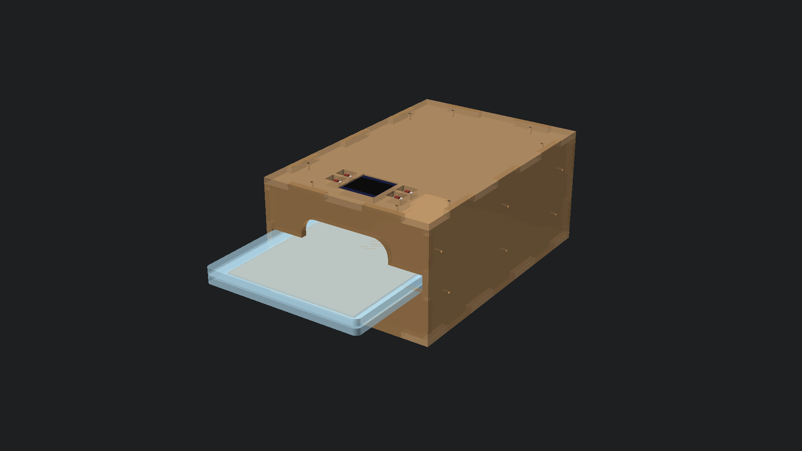
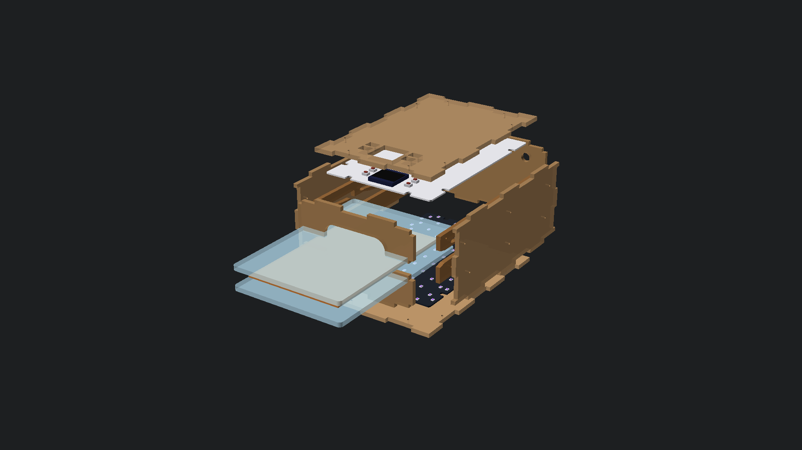

# Double-Sided UV-LED Illuminator (Insoleuse) Case

Part of the **[AETZBOX DIY Mobile PCB Etching KIT](https://wiki.sgmk-ssam.ch/index.php/EtchingBox)** by SGMK (Swiss Mechatronic Art Society).



A fully parametric, laser-cut plywood enclosure designed in [OpenSCAD](UV-Illuminator.scad) to hold two facing UV-LED matrix boards for simultaneous double-sided exposure of photo-resist PCBs ($100 \times 160\text{ mm}$ Eurocard format).

---

## 💡 Overview & Key Features

* **Simultaneous Double-Sided Exposure**: Holds two identical UV-LED boards facing each other ($180 \times 120\text{ mm}$, 84 UV LEDs each) at a fixed $74\text{ mm}$ spacing ($\approx 31.4\text{ mm}$ optical distance to the centered target PCB).
* **Direct Screw Mounting (No Spacers)**: Both PCBs screw directly flat onto the inside face of the Top and Bottom plywood plates using their 8 semicircular edge notches ($2.5\text{ mm}$ pilot holes for M2.5/M3 wood screws).
* **Top Cover UI Cutouts**: Calibrated cutouts for the Top PCB's backside $0.96''$ I2C OLED display window ($28.5 \times 29\text{ mm}$) and 4 tactile pushbuttons ($9 \times 12\text{ mm}$).
* **Plexi Carrier Plates**: Uses two existing clear acrylic carrier plates ($180 \times 120 \times 4.8\text{ mm}$, $R \approx 4\text{ mm}$ corners) sliding in from the **shorter ($120\text{ mm}$) side**.
* **2-Piece Short Entry Wall**: Split into separate Lower and Upper pieces to eliminate fragile bridges:
  * Lower piece top edge sits flush with the internal rail runner ($Z = -5.6\text{ mm}$) for seamless sliding.
  * Generous **$70.0\text{ mm}$ wide $\times 44.4\text{ mm}$ high** central finger grip opening allows thumb and fingers to firmly pinch the plexi sandwich.
* **Single-Piece Spring Rails**: Each long wall mounts a flat laser-cut rail with **3 flexible leaf springs** per side (6 total):
  * **180° Hairpin U-Loop Neck**: Eliminates notch stresses, distributing bending strain across a smooth arc.
  * **$6.0\text{ mm}$ Tip Clearance Gap**: Prevents the spring tips from rubbing or binding against the cavity wall when deflecting upward.
  * **Continuous Soft Retention**: Applies $\approx 1.4\text{ kg}$ total holding force across the sandwich, automatically compensating for Bungard photo boards from **$0.5\text{ mm}$ to $1.6\text{ mm}$** thick.
* **Glue-Together Finger Joints**: Dynamic, robust mortise & tenon joints ($30\text{ mm}$ wide tabs) designed for clean glue assembly without requiring T-slot screw hardware.

---

## 📐 Exploded Assembly & Internal Mechanics



### Sandwich Travel & Flexure Mechanics

| Component | Dimensions / Values | Notes |
| :--- | :--- | :--- |
| **Material Sheet** | $4.6\text{ mm}$ Birch/Poplar Plywood | Parameter: `thickness = 4.6` (adjustable with $0.1\text{ mm}$ precision) |
| **Enclosure Size** | $197.2 \times 131.2 \times 86.4\text{ mm}$ | Outer footprint |
| **Inner Cavity** | $188.0 \times 122.0 \times 77.2\text{ mm}$ | Internal clearance |
| **Plexi Plates** | $2\times\ 180 \times 120 \times 4.8\text{ mm}$ | Acrylic carrier sandwich |
| **Target PCB** | $0.5\text{ mm}$ to $1.6\text{ mm}$ | Single or double-sided Bungard photo board |
| **Total Sandwich** | $10.1\text{ mm}$ to $11.2\text{ mm}$ | $2\times 4.8\text{ mm} + \text{PCB}$ |
| **Slide Opening** | $12.4\text{ mm}$ | $Z = -5.6\text{ mm}$ to $+6.8\text{ mm}$ |
| **Spring Flexure** | $t = 1.8\text{--}2.7\text{ mm}$ neck | Bending stress $\sigma \approx 20\text{--}37\text{ MPa}$ (safe against fatigue) |
| **Clamping Force** | $\approx 140\text{--}260\text{ g}$ per finger | $\approx 1.4\text{ kg}$ total holding force across 6 fingers |
| **Tip Clearance** | $6.0\text{ mm}$ | Open horizontal gap at the end of each spring cavity |

---

## 📁 Repository Files

* **[`UV-Illuminator.scad`](UV-Illuminator.scad)**: Complete parametric OpenSCAD model (Source of Truth).
* **[`UV-Illuminator.json`](UV-Illuminator.json)**: OpenSCAD Customizer presets (including default `test1_4.7`).
* **[`UV-Illuminator-4mm-Enclosure.svg`](UV-Illuminator-4mm-Enclosure.svg)**: 2D vector laser cut sheet for $4.6\text{ mm}$ plywood.
* **[`UV-Illuminator-4mm-Enclosure.dxf`](UV-Illuminator-4mm-Enclosure.dxf)**: 2D CAD/CAM DXF export for laser cutters.
* **[`OpenSCAD-3D-Assembly.png`](OpenSCAD-3D-Assembly.png)**: 3D render of the assembled illuminator (front isometric view).
* **[`OpenSCAD-3D-FrontEntry.png`](OpenSCAD-3D-FrontEntry.png)**: 3D close-up view of the front entry slot and finger grip.
* **[`OpenSCAD-3D-Exploded.png`](OpenSCAD-3D-Exploded.png)**: 3D exploded view diagram.
* **[`Spring-Clearance-Detail.png`](Spring-Clearance-Detail.png)**: Close-up diagram of the $6.0\text{ mm}$ spring tip expansion gap.
* **[`Spring-Flexure-Analysis.png`](Spring-Flexure-Analysis.png)**: Finite beam mechanics and stress analysis.
* **[`UV-Illuminator-Preview.png`](UV-Illuminator-Preview.png)**: Dimensioned technical layout overview.

---

## 🛠️ Fabrication & Laser Cutting

1. **Material**: $4.6\text{ mm}$ (or $4.0\text{ mm}$) laser-grade birch or poplar plywood ($430 \times 415\text{ mm}$ minimum sheet size).
2. **Laser Kerf**: Default kerf is calibrated to $0.10\text{ mm}$ for a snug, tight glue fit with standard wood glue (PVA).
3. **Hardware Needed**:
   * $12\times$ Small countersunk wood screws ($\approx 2.5 \times 8\text{ mm}$ or $3.0 \times 8\text{ mm}$) to screw the 2 flat side rails onto the inside of the Long Front & Back walls.
   * $16\times$ Small wood screws ($\approx 2.5 \times 6\text{ mm}$) to secure the 8 notches on each UV-LED board directly to the Top and Bottom plywood plates.

---

## 🖥️ Using the OpenSCAD Customizer & CLI

### In the OpenSCAD GUI:
1. Open [`UV-Illuminator.scad`](UV-Illuminator.scad) in OpenSCAD.
2. Ensure **View → Hide Customizer** is unchecked.
3. Switch presets or tweak parameters with $0.1\text{ mm}$ precision:
   * `thickness`: Plywood thickness ($4.6\text{ mm}$).
   * `tab_width`: Finger joint width ($30.0\text{ mm}$).
   * `finger_hole_w`: Front entry finger opening ($70.0\text{ mm}$).
   * `side_wall_screw_d`: Pilot holes for wood screws ($2.0\text{ mm}$).
4. Select `render_mode = "2d_cut_sheet"` and press **F6** to render, then **File → Export as SVG / DXF**.

### From the Command Line:
```bash
# Export laser cut SVG sheet:
openscad -D 'render_mode="2d_cut_sheet"' -o UV-Illuminator.svg UV-Illuminator.scad

# Export CAD/CAM DXF sheet:
openscad -D 'render_mode="2d_cut_sheet"' -o UV-Illuminator.dxf UV-Illuminator.scad

# Render 3D assembly preview image:
openscad -D 'render_mode="3d_assembly"' --imgsize=1920,1080 -o assembly.png UV-Illuminator.scad
```

---

<div align="center">

[](https://dusseiller.ch/)

*Bruce Lee rules · Open source hardware — hack, remix, share.*

</div>

